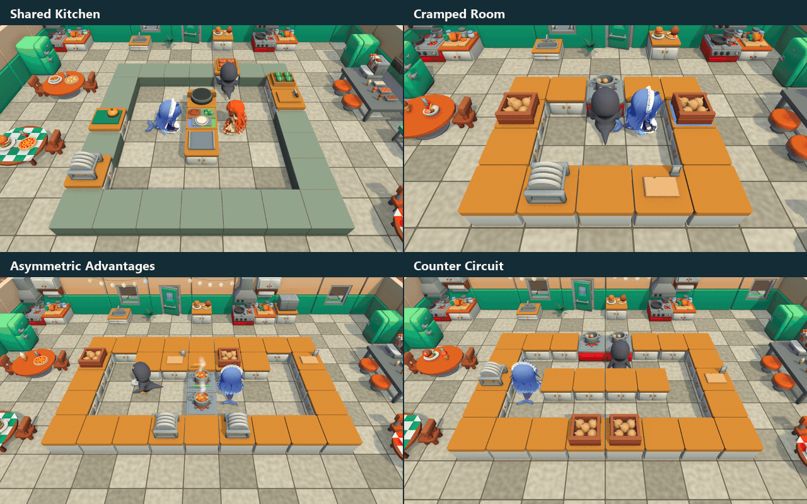
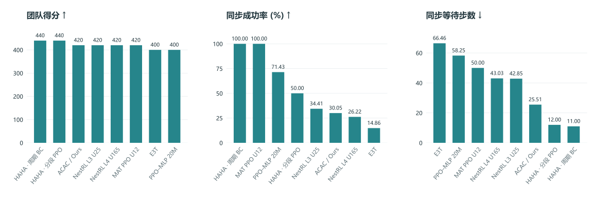
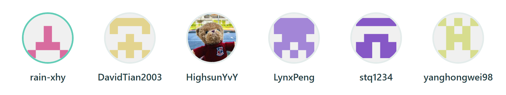

<p align="center">
  
</p>

<p align="center">
  <a href="#演示"></a>
  <a href="#方法"></a>
  <a href="#实验成绩"></a>
  <a href="#运行说明"></a>
  <a href="#参考仓库"></a>
  <a href="#贡献者"></a>
</p>

HuCooked 以《胡闹厨房》式协作任务为载体，探索多智能体深度强化学习在复杂地图中的分工与配合。研究关注取料、加工、交接和上菜之间的任务衔接，以及空间约束与共享资源下的协同决策。

当前实验以 **三人 SharedKitchen、连续混合订单、每局 300 步** 为核心，汇集 ACAC、NestRL、HAHA、E3T、MAT 与多组基线实现。可以先看真实回放，再用仓库内的模型在 CPU 上完成一次评测。

## 演示

<p align="center">
  <a href="docs/images/kitchen-gallery.gif">
    
  </a>
  <br>
  <sub>四种厨房 · 日景正视图 · 10 秒同步展示 · 点击查看原图</sub>
</p>

从三人共享厨房到经典双人地图，四个画面展示真实对局中的备料、协作与出餐。各片段使用相同播放速度，地图名称标注在画面上方。

<details>
<summary>地图、策略与回放来源</summary>

| 位置 | 地图 | 智能体 / 策略 | 原始回放 |
| :--- | :--- | :--- | :--- |
| 左上 | Shared Kitchen | 三人共享 `420sprint` 策略 | [下载](docs/media/hy420.replay.json) |
| 右上 | Cramped Room | 上游自我对弈模型 | [下载](docs/media/cramped_room.ocrep.json) |
| 左下 | Asymmetric Advantages | 上游 `GreedyHumanModel` | [下载](docs/media/asymmetric_advantages.ocrep.json) |
| 右下 | Counter Circuit | 上游 `GreedyHumanModel` | [下载](docs/media/counter_circuit_o_1order.ocrep.json) |

共享厨房使用 fork 中的 `hy` 环境 `de37e08` 和 `420sprint` 第 60 次更新的模型，该次完整对局在 300 步内完成 21 份餐、获得 420 分。其余三图使用同一 fork 中保留的上游原生环境。Cramped Room 使用 `checkpoint-550` 自我对弈模型，另外两图使用规划策略。

四个片段各截取 60 个环境步，来自独立对局。回放器使用本地 `codex/v3-replay` 的 `072387b` 版本，由 Unity 6000.6.9f1 渲染。合成 GIF 为 1280 × 800、12 FPS，并统一做了小幅饱和度与对比度调整。

</details>

## 方法

一份餐需要经过取料、烹饪、切配、装盘和送餐。普通订单可由一名厨师出锅，协作订单要求两名厨师在锅的两侧**同一步交互**；第三名厨师可以并行准备配菜、餐盘或送餐。各方法围绕这个共同任务，探索不同的分工与协调方式。

| 方法与实现 | 协作思路 |
| :--- | :--- |
| [**ACAC / Ours**](docs/branches/hy.md) | 预测队友到位情况，结合宏动作评分与学习式开局分工 |
| [**NestRL · 历史编码与 L1–L4**](src/nest_rl/README.md) | 以分层历史编码建模队友行为，结合多阶段训练探索协作适应；当前 L1–L4 使用无历史 Ego-MLP，逐步加入多样队友、自博弈和出生／动作扰动 |
| [**HAHA / 分段 PPO**](docs/branches/fgy.md) | 分层 Manager–Worker；比较规则模仿、规划器辅助和高层技能分配 |
| [**E3T**](src/e3t_20m/README.md) | 用历史预测队友动作，为工作站选择策略提供条件信息；从随机初始化在线训练 |
| [**MAT**](src/mat/README.md) | Transformer 读取团队观测，依次生成三名厨师的动作；示范微调后继续 PPO |
| [**LIPO / CoMeDi / HiPT / PPO**](src/stq/README.md) | 26 组实验对比分开与联合动作、BC→RL 与纯 RL，以及 MLP、CNN、Transformer 骨干 |

共享环境统一固定为 **`overcooked_env@508bcbf`**。方法各自保留训练时的观测编码和动作接口：原始动作策略直接输出移动、等待或交互，高层策略通过自己的执行器转换成环境动作。训练奖励按方法分别配置；下面的结果使用环境输出指标。

## 实验成绩

### SharedKitchen · 代表性结果

以下展示 8 个检查点已归档的默认连续订单评测，每局 300 步，三名厨师由对应策略控制。三个子图分别按数值从高到低排列；得分和同步成功率越高越好，等待步数越低越好。默认每份餐得 20 分，出餐数与团队得分成正比，因此图中仅展示得分。

<p align="center">
  <a href="docs/images/benchmark-summary.png"></a>
</p>

不同方法的种子、训练预算与选模方式分别记录在各自文档中；同步成功率的汇总口径见下表。

<details>
<summary>原始数据、评测局数与来源</summary>


| 方法 / 检查点 | 局数 | 得分 ↑ | 出餐 ↑ | 同步成功率 ↑ | 等待步数 ↓ |
| :--- | ---: | ---: | ---: | ---: | ---: |
| [ACAC / Ours · 学习开局分工](docs/branches/hy.md) | 96 | 420.00 | 21.00 | 30.05%¹ | 25.51 |
| [NestRL L3 · U25](src/nest_rl/README.md) | 96 | 420.00 | 21.00 | 34.41% | 42.85 |
| [NestRL L4 · U165](src/nest_rl/README.md) | 96 | 420.00 | 21.00 | 26.22% | 43.03 |
| [HAHA · 周期规则 BC](src/haha/leaderboard/shared/README.md) | 24 | **440.00** | **22.00** | 100.00%¹ | 11.00 |
| [HAHA · 分段高层 PPO](src/haha/leaderboard/shared/README.md) | 24 | **440.00** | **22.00** | 50.00%¹ | 12.00 |
| [E3T · 开发集入选模型](src/e3t_20m/README.md) | 100 | 400.00 | 20.00 | 14.86% | 66.46 |
| [MAT · PPO U12](src/mat/README.md) | 128 | 420.00 | 21.00 | 100.00% | 50.00 |
| [PPO–MLP · small，20M 步，纯 RL](src/stq/RESULTS.md) | 12 | 400.00 | 20.00 | 71.43% | 58.25 |

<sub>得分、出餐与等待步数均为每局均值。同步成功率默认先按局计算再平均；标记 ¹ 的行按总成功次数 / 总尝试步数汇总。此表摘录不同实验协议的结果，统一种子下的跨方法评测尚未完成。</sub>

[图表数据](docs/benchmark-summary.csv) · [绘图脚本](scripts/plot_benchmark_summary.py)

</details>

<details>
<summary>指标含义、完整基线与核验记录</summary>

- **团队得分**：`team_score`；默认每份普通餐或协作餐均得 20 分。
- **出餐数**：`meals_completed`，包括普通餐与协作餐。
- **同步成功率**：`joint_attempt_success_rate`，成功协作出锅次数除以有效尝试步数，不是协作餐占全部餐数的比例。
- **等待步数**：`joint_wait_steps = joint_ready_steps − joint_successes`。高同步成功率也可能伴随较长等待，应结合产量一起观察。
- **完整实验**：[HAHA 五版榜单](src/haha/leaderboard/shared/README.md) · [STQ 全部 26 组结果](src/stq/RESULTS.md) · [NestRL 阶段与队友对照](src/nest_rl/README.md)。
- **MAT 合并核验**：在当前环境上复跑 128 局，逐局指标与归档一致；同时核对全部 300 步回放动作、事件与奖励。可用 `python -m src.mat.verify_shared` 重跑核验。

</details>

### NestRL L4 · 随机出生与队友扰动

L4 从 L3 U25 出发，以 **100% 全图随机出生 + 5% 队友动作扰动**训练，只使用稀疏送餐奖励。以下使用原生 SharedKitchen、相同新种子，每配置 96 局，比较三名同模型策略的团队得分。

| 评测场景 | L3 U25 | L4 U165 |
| :--- | ---: | ---: |
| 默认出生，无扰动 | 420.00 | **420.00** |
| 同地图全图随机出生 | 183.54 | **413.54** |
| 默认出生 + 5% 队友动作扰动 | 324.58 | **386.25** |

“全图随机”指同一张 7×7 地图内随机选择三个不同的地板格，并非随机生成地图。出生位置与队友动作扰动由补充评测协议施加，指标仍取自环境输出。[完整配置、跨队友结果与分析](src/nest_rl/README.md)

<sub>L5 曾尝试加入同步失败与等待惩罚，但未达到保留已有成绩的目标，已废弃；当前采用 L4。</sub>

## 运行说明

### 获取项目

先获取代码和厨房环境。模型评测无需下载 Unity 回放器及历史复现子模块。

```bash
git clone https://github.com/rain-xhy/hucooked-project.git
cd hucooked-project
git submodule update --init overcooked_env
```

<details>
<summary>需要 Unity 回放器或完整历史复现代码？</summary>

```bash
git submodule update --init --recursive
```

Windows 遇到路径过长时，使用 `git -c core.longpaths=true submodule update --init --recursive`。

</details>

### 第一次评测 · 用 CPU 跑 MAT

MAT 的 3 个归档权重已随仓库提供，总计约 1.67 MB。以下命令在仓库根目录执行，使用独立的项目 Conda 环境；已有适用的项目环境时可直接复用。

```bash
conda create --prefix ./.conda python=3.12 -y
conda activate ./.conda
python -m pip install -r src/mat/requirements.txt
python -m src.mat.evaluate_shared --episodes 1 --seed 200000 --output runs/mat/evaluation.json
```

默认加载 `runs/mat/shared-ppo-best.pt`，结果写入 `runs/mat/evaluation.json`。该种子的归档结果为 **420 分、21 份餐、同步成功率 100%、等待 50 步**。将 `--episodes` 改为 `128` 可运行完整评测；各方法依赖分别维护，其他方法的安装和训练步骤见下表。

### 选择方法与权重

| 步骤 | 入口 |
| :--- | :--- |
| 环境安装 | [厨房环境说明](overcooked_env/README.md)，当前共享厨房固定为 `overcooked_env@508bcbf` |
| 查看回放 | [回放前端说明](replay_frontend/README.md) |
| ACAC 协作 | [方法组件与评估结果](docs/branches/hy.md) |
| NestRL | [训练配置、复现命令与 L1–L4 评测](src/nest_rl/README.md)，L5 已废弃 |
| STQ 基线 | [LIPO、CoMeDi、HiPT 与 PPO 训练和评测](src/stq/README.md) |
| HAHA 与分段 PPO | [训练入口、共享厨房榜单与权重复评](docs/branches/fgy.md) |
| E3T | [在线训练、开发集选型与留出评测](src/e3t_20m/README.md) |
| MAT（tzw） | [训练、128 局评测与原生回放](src/mat/README.md) |

| 权重 | 获取位置 |
| :--- | :--- |
| NestRL L1–L4 | [`runs/nest_rl/`](runs/nest_rl/)：L1 四个队友池权重、L2 U200、L3 U25、L4 U165 |
| HAHA | [`runs/haha/`](runs/haha/)：SharedKitchen 五版及历史环境权重 |
| MAT | [`runs/mat/`](runs/mat/)：固定订单、示范微调与 PPO 三个检查点 |
| STQ 基线 | [Release 下载与解压说明](src/stq/README.md#下载权重和训练记录)；准确文件列表见 [实验清单](src/stq/experiments.json) |
| ACAC / E3T | ACAC 需补齐外部 ACAC 依赖与模型权重；E3T 权重由训练生成，仓库提供已完成实验的结果记录 |

已入库模型的文件大小、来源和 SHA-256 见 [`runs/checkpoints.json`](runs/checkpoints.json)。完整续训状态与未入选快照留在本地，不随 Git 分发。

<details>
<summary>项目目录</summary>

```text
.
├── overcooked_env/   # 共享厨房环境（508bcbf）
├── replay_frontend/  # 回放前端子模块
├── src/
│   ├── acac_ours/   # ACAC 协作方法
│   ├── nest_rl/     # NestRL 复现与训练
│   ├── stq/         # 基线复现与 PPO 实验
│   ├── haha/        # HAHA、分段 PPO 与榜单
│   ├── e3t_20m/     # E3T 队友预测与在线训练
│   └── mat/         # TZW Multi-Agent Transformer
├── scripts/         # 运行与实验脚本
├── tests/           # 测试
├── runs/            # 按方法归档的权重与本地实验输出
└── docs/            # 项目文档
```

<sub>精选模型权重见 <a href="runs/README.md">runs/</a>；其余训练输出、Python 环境与缓存由 .gitignore 忽略。STQ 权重继续通过 Release 分发。</sub>

</details>

## 参考仓库

| 仓库 | 与本项目的关系 |
| :--- | :--- |
| [HumanCompatibleAI / overcooked_ai](https://github.com/HumanCompatibleAI/overcooked_ai) | Overcooked-AI 上游协作环境 |
| [rain-xhy / hucooked](https://github.com/rain-xhy/hucooked) | 本项目使用的厨房环境子模块 |
| [LynxPeng / Better-replay-frontend-of-overcook-ai](https://github.com/LynxPeng/Better-replay-frontend-of-overcook-ai) | 本项目使用的回放前端子模块 |
| [upasana27 / adaptive-RL](https://github.com/upasana27/adaptive-RL) | NestRL 历史复现依赖，位于 `src/nest_rl/adaptive-RL` 子模块 |

算法论文与各方法的参考来源见对应方法文档。

## 贡献者

<p align="center">
  
</p>

<p align="center">
  <a href="https://github.com/rain-xhy">rain-xhy</a> ·
  <a href="https://github.com/DavidTian2003">DavidTian2003</a> ·
  <a href="https://github.com/HighsunYvY">HighsunYvY</a> ·
  <a href="https://github.com/LynxPeng">LynxPeng</a> ·
  <a href="https://github.com/stq1234">stq1234</a> ·
  <a href="https://github.com/yanghongwei98">yanghongwei98</a>
</p>

---

<p align="center">
  <sub>深度强化学习课程小组作业 · <a href="docs/团队作业要求DRLv1-1A.md">课程项目要求</a></sub>
</p>
