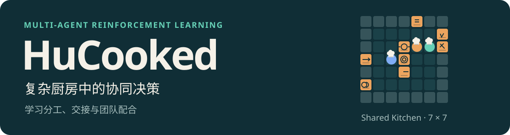

<p align="center">
  
</p>

<p align="center">
  <a href="#演示"></a>
  <a href="#方法"></a>
  <a href="#实验成绩"></a>
  <a href="#运行说明"></a>
  <a href="#参考仓库"></a>
  <a href="#贡献者"></a>
</p>

HuCooked 以《胡闹厨房》式协作任务为载体，探索多智能体深度强化学习在复杂地图中的分工与配合。研究关注取料、加工、交接和上菜之间的任务衔接，以及空间约束与共享资源下的协同决策。

## 演示

<p align="center">
  <a href="docs/images/kitchen-gallery.gif">
    
  </a>
  <br>
  <sub>四种厨房 · 日景正视图 · 10 秒同步展示 · 点击查看原图</sub>
</p>

从三人共享厨房到经典双人地图，四个画面展示真实对局中的备料、协作与出餐。各片段使用相同播放速度，地图名称标注在画面上方。

<details>
<summary>地图、策略与回放来源</summary>

| 位置 | 地图 | 智能体 / 策略 | 原始回放 |
| :--- | :--- | :--- | :--- |
| 左上 | Shared Kitchen | 三人共享 `420sprint` 策略 | [下载](docs/media/hy420.replay.json) |
| 右上 | Cramped Room | 上游自我对弈模型 | [下载](docs/media/cramped_room.ocrep.json) |
| 左下 | Asymmetric Advantages | 上游 `GreedyHumanModel` | [下载](docs/media/asymmetric_advantages.ocrep.json) |
| 右下 | Counter Circuit | 上游 `GreedyHumanModel` | [下载](docs/media/counter_circuit_o_1order.ocrep.json) |

共享厨房使用 fork 中的 `hy` 环境 `de37e08` 和 `420sprint` 第 60 次更新的模型，该次完整对局在 300 步内完成 21 份餐、获得 420 分。其余三图使用同一 fork 中保留的上游原生环境。Cramped Room 使用 `checkpoint-550` 自我对弈模型，另外两图使用规划策略。

四个片段各截取 60 个环境步，来自独立对局。回放器使用本地 `codex/v3-replay` 的 `072387b` 版本，由 Unity 6000.6.9f1 渲染。合成 GIF 为 1280 × 800、12 FPS，并统一做了小幅饱和度与对比度调整。

</details>

## 方法

研究聚焦任务分工、空间协调和场景适应，观察智能体如何衔接工序、利用交接工位，并在不同地图中形成配合。具体算法、网络结构与训练配置待补充。

<details>
<summary>方法与实现的内容框架</summary>

- **环境与任务**包括地图配置、智能体数量、观测、动作与任务规则。
- **策略学习**包括算法、网络结构、训练方式与队友配置。
- **协作机制**包括任务分工、信息利用与交接策略。
- **奖励设计**包括团队奖励、辅助奖励与对应目标。
- **评估设置**包括基线、测试地图、随机种子与评估轮次。

</details>

<!-- 后续在此补充整体方法图、策略结构与关键实现入口。 -->

## 实验成绩

训练曲线、地图性能对比图与完整结果待补充。

<!-- 图表就绪后补充统计口径、训练步数、随机种子、误差范围和原始数据位置。 -->

| 地图 / 场景 | 方法 | 团队得分 ↑ | 订单完成率 ↑ | 平均交付步数 ↓ |
| :--- | :--- | :---: | :---: | :---: |
| 待补充 | 待补充 | — | — | — |

<sub>指标统计口径、基线与评估配置将随实验结果一并补充。</sub>

## 运行说明

### 获取项目

递归克隆仓库，同时获取厨房环境与回放前端。

```bash
git clone --recurse-submodules https://github.com/rain-xhy/hucooked-project.git
cd hucooked-project
```

<details>
<summary>已有本地仓库？初始化子模块</summary>

```bash
git submodule update --init --recursive
```

Windows 遇到路径过长时，使用 `git -c core.longpaths=true submodule update --init --recursive`。

</details>

### 安装、训练与评估

| 步骤 | 入口 |
| :--- | :--- |
| 环境安装 | [厨房环境说明](overcooked_env/README.md)，当前共享厨房固定为 `overcooked_env@508bcbf` |
| 查看回放 | [回放前端说明](replay_frontend/README.md) |
| ACAC 协作 | [方法组件与评估结果](docs/branches/hy.md) |
| NestRL | [训练配置、复现命令与 L1–L4 评测](src/nest_rl/README.md)，L5 已废弃 |
| STQ 基线 | [LIPO、CoMeDi、HiPT 与 PPO 训练和评测](src/stq/README.md) |
| HAHA 与分段 PPO | [训练入口、共享厨房榜单与权重复评](docs/branches/fgy.md) |
| MAT（tzw） | [训练、128 局评测与原生回放](src/mat/README.md) |

<details>
<summary>项目目录</summary>

```text
.
├── overcooked_env/   # 共享厨房环境（508bcbf）
├── replay_frontend/  # 回放前端子模块
├── src/
│   ├── acac_ours/   # ACAC 协作方法
│   ├── nest_rl/     # NestRL 复现与训练
│   ├── stq/         # 基线复现与 PPO 实验
│   ├── haha/        # HAHA、分段 PPO 与榜单
│   └── mat/         # TZW Multi-Agent Transformer
├── scripts/         # 运行与实验脚本
├── tests/           # 测试
├── runs/            # 按方法归档的权重与本地实验输出
└── docs/            # 项目文档
```

<sub>精选模型权重见 <a href="runs/README.md">runs/</a>；其余训练输出、Python 环境与缓存由 .gitignore 忽略。STQ 权重继续通过 Release 分发。</sub>

</details>

## 参考仓库

| 仓库 | 与本项目的关系 |
| :--- | :--- |
| [HumanCompatibleAI / overcooked_ai](https://github.com/HumanCompatibleAI/overcooked_ai) | Overcooked-AI 上游协作环境 |
| [rain-xhy / hucooked](https://github.com/rain-xhy/hucooked) | 本项目使用的厨房环境子模块 |
| [LynxPeng / Better-replay-frontend-of-overcook-ai](https://github.com/LynxPeng/Better-replay-frontend-of-overcook-ai) | 本项目使用的回放前端子模块 |

<!-- 后续在此追加实际参考或使用的算法仓库，并注明对应模块。 -->

## 贡献者

<table align="center">
  <tr>
    <td align="center">
      <a href="https://github.com/rain-xhy">
        
        <br>
        <strong>rain-xhy</strong>
      </a>
    </td>
    <td align="center">
      <a href="https://github.com/HighsunYvY">
        
        <br>
        <strong>HighsunYvY</strong>
      </a>
    </td>
    <td align="center">
      <a href="https://github.com/yanghongwei98">
        
        <br>
        <strong>yanghongwei98</strong>
      </a>
    </td>
  </tr>
  <tr>
    <td align="center">
      <a href="https://github.com/LynxPeng">
        
        <br>
        <strong>LynxPeng</strong>
      </a>
    </td>
    <td align="center">
      <a href="https://github.com/stq1234">
        
        <br>
        <strong>stq1234</strong>
      </a>
    </td>
    <td align="center">
      <a href="https://github.com/DavidTian2003">
        
        <br>
        <strong>DavidTian2003</strong>
      </a>
    </td>
  </tr>
</table>

---

<p align="center">
  <sub>深度强化学习课程小组作业 · <a href="docs/团队作业要求DRLv1-1A.md">课程项目要求</a></sub>
</p>
