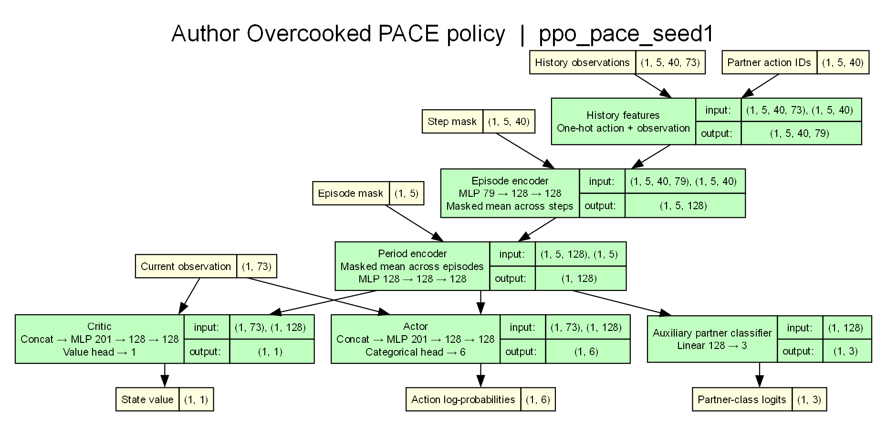

# NestRL 复现与对照实验

本目录围绕 [NestRL: A Nested Training Regime for Mutual Adaptation in Human-AI Teaming](https://arxiv.org/abs/2602.17737v2) 整理论文复现与标准 Overcooked 环境对照实验。**当前训练链路已打通，但尚不能宣称完整复现论文结果。**

## 论文与作者代码

Upasana Biswas、Durgesh Kalwar、Subbarao Kambhampati 和 Sarath Sreedharan，*NestRL: A Nested Training Regime for Mutual Adaptation in Human-AI Teaming*。本目录收录未经修改的 [arXiv v2 PDF](NestRL-2602.17737v2.pdf)。论文采用 CC BY 4.0 许可。[arXiv 记录](https://arxiv.org/abs/2602.17737v2) · [PDF 来源](https://arxiv.org/pdf/2602.17737v2) · [许可](https://creativecommons.org/licenses/by/4.0/)

PDF 的 SHA-256 为 `c81b9eec95d79929b2516d18ecf0c2ec95cb9ee3deff1837a8be51f187819a7b`。arXiv 主站和官方镜像下载的文件逐字节一致。

`adaptive-RL/` 是作者代码子模块，固定到提交 `33bb3222563735893ceb9258ebd3ea310583a148`。 [作者代码固定版本](https://github.com/upasana27/adaptive-RL/tree/33bb3222563735893ceb9258ebd3ea310583a148)

## 两条实验路线

| 目录 | 目标 | 当前状态 |
| --- | --- | --- |
| [orgin/](orgin/) | 论文原始复现：使用论文作者改进的胡闹厨房环境和论文的嵌套训练方法训练、评估 L1/L2 策略。 | 已有训练、评估和性能工具；当前训练配置与论文仍有差异，详见下表。 |
| [cnn_standard/](cnn_standard/) | 标准 Overcooked 环境的空间观测与 CNN 实验，作为后续对照路线。 | 仅建立目录和说明，尚未实现或验证。 |

训练脚本、评估脚本和依赖清单位于 `orgin/`。原始复现使用 `orgin/.conda/`，训练和评估产物分别写入 `orgin/runs/` 和 `orgin/checkpoint-eval/`。标准路线使用独立的 `cnn_standard/.conda/`。两个环境和本地运行产物均被 Git 忽略。

## 复现进度与计划

勾选表示已有对应代码或历史验证，**不表示已经完成论文级复现**。历史结果和可执行命令见下方的[原始复现](#从哪里开始)。

| 状态 | 工作项 | 现状 / 下一步 |
| --- | --- | --- |
| [x] | 获取论文与作者代码 | 保存论文 v2，固定作者 `adaptive-RL` 子模块版本。 |
| [x] | 作者环境与权重评估 | 已使用作者环境、配置和公开 PACE checkpoint 进行规则伙伴评估；不同伙伴模式的结果见详细说明。 |
| [x] | L1 与 L2 训练链路 | 已有从零训练 L1、使用冻结 L1 checkpoint 池训练 L2 的入口；短训练验证了链路，短跑不代表任务学成。 |
| [x] | 训练性能与记录工具 | 已有串行、子进程和 GPU 厨房相关实现，以及历史编码、profiling、学习率和可选 Trackio 记录工具。各模式的适用条件和结果需按配置验证。 |
| [x] | hucooked 特征适配探索 | 已有将本项目汤任务状态近似映射到 NestRL 73 维特征的适配器及检查脚本；它是迁移探索，不是论文原始环境复现。 |
| [ ] | 对齐论文训练设置 | 核对并实现附录 B.3 的 RNN 历史编码、网络与训练参数；当前脚本使用 MLP 历史编码，不能称为完整对齐。 |
| [ ] | 补齐论文评估条件 | 确认论文 L2 权重及完整自适应测试伙伴池的获取方式，建立与论文一致的训练、验证和测试划分。 |
| [ ] | 完成论文规模训练与复现实验 | 在对齐后的配置下完成多种子训练、评估与结果汇总，并和论文指标逐项比较；记录配置、种子和差异。 |
| [ ] | 实现标准环境 CNN | 在 `cnn_standard/` 接入标准环境的空间编码、CNN 策略及训练与评估入口，并明确地图尺寸和通道数的处理方式。 |
| [ ] | 设计可比对照实验 | 固定环境版本、地图、训练预算、种子、伙伴与指标，比较标准环境 CNN 路线和论文复现路线，说明环境和编码差异。 |

## 从哪里开始

原始复现使用作者的 Overcooked 环境与 `fc_small_test.yaml`。从仓库根目录初始化子模块并进入 `orgin/`。下文的绘图、评估和训练命令均从这个目录运行。

```powershell
git submodule update --init -- reproduction/nest_rl/adaptive-RL
Set-Location reproduction/nest_rl/orgin
```

已有 `orgin/.conda/` 时可直接复用。首次安装时，在 `orgin/` 中创建 Windows CPU 环境。

```powershell
conda create --prefix .conda python=3.10 pip -y
conda run --prefix .conda python -m pip install --index-url https://download.pytorch.org/whl/cpu torch==2.9.1+cpu
conda run --prefix .conda python -m pip install -r requirements.txt
conda run --prefix .conda python -m pip install --no-deps --ignore-requires-python pettingzoo==1.9.0 stable-baselines3==1.7.0
```

作者旧版 Gym 接口在 Windows 上使用 Gym 0.23.1。PettingZoo 1.9.0 的元数据限制 Python 版本，Stable-Baselines3 1.7.0 声明依赖 Gym 0.21。上述安装命令为 checkpoint 评估选用兼容版本组合。

标准环境 CNN 路线的独立环境见 [cnn_standard/README.md](cnn_standard/README.md)。

## 模型架构说明

两张结构图由 Torchview 跟踪作者公开的 PACE 权重得到。它们展示的是同一种 Actor–Critic 主干和两级 MLP 历史编码器，两种权重的辅助队友分类头宽度不同。下面的形状以绘图批次 `B=1`、历史窗口 `E=5` 局、每局 `T=40` 步为例。 [Torchview](https://github.com/mert-kurttutan/torchview)

### 输入与掩码

| 输入 | 图中形状 | 含义 |
| --- | --- | --- |
| 当前观测 | `(1, 73)` | 当前决策时刻的 73 维环境特征 |
| 历史观测 | `(1, 5, 40, 73)` | 每个样本有 5 个对局槽位，每局有 40 个时间步槽位，每步存一条 73 维观测 |
| 队友动作编号 | `(1, 5, 40)` | 历史中每步存一个队友动作编号，编码时转换成 6 维 one-hot |
| Step mask | `(1, 5, 40)` | `True` 表示聚合时跳过该步，例如尚未发生或用于补齐的步 |
| Episode mask | `(1, 5)` | `True` 表示跨局聚合时跳过整局 |

历史动作编号和 Step mask 形状相同，各自的元素分别是整数和布尔值。作者的编码器把缺失队友动作的编号 `-1` 编成 6 个零。动作缺失和步掩码是独立的信息，步是否参与平均由掩码决定。 [输入编码](https://github.com/upasana27/adaptive-RL/blob/33bb3222563735893ceb9258ebd3ea310583a148/learning/model.py)

### 历史编码与策略输出

1. **逐步编码。** 每步的 73 维观测与 6 维队友动作编码拼成 79 维，历史张量变为 `(1, 5, 40, 79)`。同一个 MLP 将每步的特征从 `79 → 128 → 128`。
2. **Episode encoder。** 每局只对有效步的 128 维特征求均值，输出 `(1, 5, 128)`。例如某局走了 12 步，其局向量由这 12 步决定。
3. **Period encoder。** 对有效局的向量求均值，再通过 `128 → 128 → 128` 的 MLP 和最后的 ReLU，得到 `(1, 128)`。两局各有 10 步和 40 步时，只要两局都有效，各占跨局平均的一半。整段历史为空时，掩码均值给后置 MLP 一个零向量，最终表示还取决于 MLP 的偏置。
4. **Actor 和 Critic。** 分别把当前的 73 维观测与共享的 128 维历史表示拼成 201 维，然后各自通过 `201 → 128 → 128` 的 MLP。Actor 的分类分布提供 6 个动作的对数概率，Critic 的线性输出头给出 1 个状态价值。

这套编码器学习每步的观测和队友动作之间的关联。给定同一组有效的观测与动作配对，仅打乱局内的步顺序，或者仅调换已编码的有效局，两级均值结果保持相同。 [作者的模型实现](https://github.com/upasana27/adaptive-RL/blob/33bb3222563735893ceb9258ebd3ea310583a148/learning/model.py)

### 辅助队友分类与联合训练

辅助分类头将 128 维历史向量映射为训练池中各队友策略的 logits。训练时以实际配对的队友策略编号作标签，用交叉熵鼓励历史编码器保留可区分队友的信息。执行时，Actor 根据当前观测和历史向量直接选动作。

| 作者公开权重 | 辅助分类头 | Actor 输出 |
| --- | --- | --- |
| `ppo_pace_seed1` | `Linear 128 → 3`，3 类队友策略 | 6 个动作的对数概率 |
| `ppo_pace_two_ing_*_seed1` | `Linear 128 → 2`，2 类队友策略 | 6 个动作的对数概率 |

PPO 更新会根据小批次的历史索引重新计算带梯度的历史向量。策略损失和熵项通过 Actor 回传到编码器，价值损失通过 Critic 回传到编码器。公开权重的训练配置还以 `1.0` 为系数，将同一个 PPO 小批次上的队友分类交叉熵加入总损失。这个交叉熵同时更新分类头和历史编码器。 [作者的 PPO 更新](https://github.com/upasana27/adaptive-RL/blob/33bb3222563735893ceb9258ebd3ea310583a148/learning/algo/ppo_.py)

### 本地 L1、L2 与论文的关系

本地 L1 和 L2 共用 MLP 历史编码器、Actor 和 Critic 的架构，训练各自的参数。实际比对 `l1-right-s1` 和 `l2-left-s3` 的权重后，两者的参数名与形状一致，各有 145,415 个参数。当前本地从零训练启用了端到端 PPO 和使用历史向量的 Critic，辅助队友分类尚未启用。 [本地训练参数](orgin/train_nestrl.py)

| 学习中的策略 | 训练队友 |
| --- | --- |
| L1 | 固定的 L0 规则策略，每种策略专门做一种食谱 |
| L2 | 冻结的 L1 策略。它们的权重固定，仍会根据各自的交互历史调整动作 |

嵌套体现在逐级更换训练队友。L2 运行自己的历史编码器与策略，训练时由独立的 L1 模型充当搭档。论文附录 B.3 对各层的历史编码描述使用 RNN，并通过 PPO 端到端优化。这里的 MLP 与均值聚合来自作者公开的 PACE 权重和本地复现配置。 [论文附录 B.3](https://arxiv.org/html/2602.17737v2#A2.SS3)

### 结构图与生成方式

**`ppo_pace_seed1` · 3 类辅助分类头**



[SVG 矢量图](orgin/model_graphs/author_pace_policy.svg) · [DOT 源文件](orgin/model_graphs/author_pace_policy.dot)

**`ppo_pace_two_ing_1_seed1` · 2 类辅助分类头**


[SVG 矢量图](orgin/model_graphs/ppo_pace_two_ing_1_seed1.svg) · [DOT 源文件](orgin/model_graphs/ppo_pace_two_ing_1_seed1.dot)

[绘图脚本](orgin/draw_author_model.py)会将动作、价值和辅助分类输出与原策略逐项核对。Torchview 漏掉了作者代码中经过原地赋值的一条依赖，脚本按实际数据流补上了从局编码器到跨局编码器的连线。

在 `orgin/` 中运行以下命令可重新生成两张图。需先安装 [Graphviz](https://graphviz.org/download/)，并确保 `dot` 在 PATH 中。

```powershell
conda run --prefix .conda python -m pip install torchview==0.2.7 graphviz==0.21
conda run --prefix .conda python draw_author_model.py
conda run --prefix .conda python draw_author_model.py --checkpoint ppo_pace_two_ing_1_seed1
```

## PACE 权重评估

用作者的 `ppo_pace_seed1` 权重与指定食谱的固定规则伙伴搭档，默认随机种子为 1，运行 10 轮，每轮 5 局。每轮局数与 checkpoint 的历史窗口一致。

```powershell
conda run --no-capture-output --prefix .conda python evaluate_pace.py --recipe lettuce-onion
conda run --no-capture-output --prefix .conda python evaluate_pace.py --recipe lettuce-onion --partner-mode minimum
```

原评估入口从 `environment/overcooked/policy.py` 取 `minimum` 伙伴。这种伙伴会取食材、放到隔板，并在成品可用时尝试送餐，但不切菜或装盘。作者的 L1 规则池在 `environment/overcooked/policy_server.py` 选用 `full`。保持 checkpoint、地图、初始随机种子和轮数一致，替换伙伴得到下列结果。

| 伙伴模式 | 食谱 | 完成局数 | 成功率 |
| --- | --- | ---: | ---: |
| `minimum` | Lettuce–Onion | 0/50 | 0% |
| `full` | Lettuce–Onion | 47/50 | 94% |
| `full` | Tomato–Carrot | 44/50 | 88% |
| `full` | Potato–Broccoli | 46/50 | 92% |

评估入口默认选择 `full`。它把指标字典从作者评估函数的两个返回值中取出，供原 CLI 汇总。逐局监控数据及结果 pickle 按权重、种子、伙伴模式和食谱存入 `checkpoint-eval/`。

## 从零训练 L1 和 L2

下面的命令以默认短训练设置启动两次右侧 L1 和一次左侧 L2。每个 L1 与三种全功能规则伙伴训练。L2 的训练池使用种子 1 的 L1，评估池使用种子 2 的 L1。每次运行使用一个独立的 `--run-name`，权重和启动配置写入 `runs/<run-name>/`。

```powershell
conda run --no-capture-output --prefix .conda python train_nestrl.py l1 --player 1 --seed 1 --run-name l1-right-s1
conda run --no-capture-output --prefix .conda python train_nestrl.py l1 --player 1 --seed 2 --run-name l1-right-s2
conda run --no-capture-output --prefix .conda python train_nestrl.py l2 --player 0 --seed 3 --run-name l2-left-s3 --partners runs/l1-right-s1/ppo/latest.pt --eval-partners runs/l1-right-s2/ppo/latest.pt
```

| 短训练 | 交互步数 | PPO 更新 | 末次评估完成局数 |
| --- | ---: | ---: | ---: |
| 右侧 L1，种子 1 | 1,200 | 2 | 0/15 |
| 右侧 L1，种子 2 | 1,200 | 2 | 0/15 |
| 左侧 L2，种子 3 | 400 | 2 | 0/5 |

公开训练入口默认只接规则伙伴池。训练脚本复用原来的 PPO、环境及历史缓冲区，在本地接入 L1 checkpoint 池，冻结 L1 参数，并在每步写入 L1 的观测和对手动作。L1 在每个五局回合中保留上下文，换回合清空。L2 评估中有 4/5 局在开局时读到了前面各局的历史。CPU 适配还处理了训练入口重复压缩动作维度的问题，以及规则伙伴无法向目标移动时的等待动作。

短训练用于验证链路。它沿用公开 checkpoint 配置中的 MLP 历史编码，论文附录 B.3 描述的是 RNN 历史编码。论文所用的 L2 权重及完整的自适应测试伙伴池没有出现在当前公开 checkout 中。可通过 `--rollout-steps`、`--updates`、`--processes` 调整本地训练规模。交互步数为三者乘积，厨房数至少等于训练搭档数，搭档按厨房编号轮流分配。 [论文附录 B.3](https://arxiv.org/html/2602.17737v2#A2.SS3)

## 并行厨房与性能测量

训练默认使用 `--env-mode serial`。至少配置两个厨房时，可用 `--env-mode subprocess` 为每个厨房启动独立进程，或指定 `--workers` 让多个厨房共享一个进程。工作进程数必须整除厨房数。每个 L2 厨房在 CPU 上加载自己的冻结 L1 搭档并维护历史，评估使用串行厨房。使用 CUDA 版 PyTorch 时，可加 `--device cuda` 在 GPU 上运行主策略和 PPO。

`--processes 3 --rollout-steps 400 --updates 5 --profile` 会采集 6,000 个训练环境步，并在运行目录写入 `profile.json`。其中主进程计时为墙钟秒，厨房计时按环境分别记录。多进程下各厨房的计时有重叠。

CUDA 策略采样默认将 MLP 历史编码整批执行。PPO 反向传播使用作者的编码路径。可用 `--history-encoder original` 对照原版。24 个厨房的 6,000 步短跑使用 `--device cuda --env-mode subprocess --processes 24 --rollout-steps 50 --updates 5`，每轮 PPO 收集 1,200 条交互样本。

`--ppo-mini-batch-size` 指定每次优化器更新使用的样本数。128 厨房短跑使用 `--device cuda --env-mode subprocess --processes 128 --workers 16 --rollout-steps 48 --updates 1 --ppo-mini-batch-size 512 --profile`。单轮采集 6,144 条样本，每遍训练恰好分成 12 个小批次。

## 学习率与 Trackio

`--learning-rate` 默认是 `0.001`。安装 Trackio 后，可加 `--trackio-project <name>` 将 PPO 指标和评估结果按环境步数记录到 `runs/trackio/<name>.db`。`--eval-every-updates` 控制评估间隔，须整除 `--updates`。`--eval-rounds` 指定每次评估对每个搭档重复的五局回合数。各回合使用固定评估种子，并在评估结束后恢复训练随机数状态。

`--lr-warmup-updates` 默认为 0。启用后，前几轮 PPO 按实际 Adam 更新次数将学习率从目标值的 10% 线性升至目标值。Trackio 每轮记录起始和结束学习率。

`--trackio-sample-every` 可在长 rollout 内按向量环境步记录已结束局的奖励、成功率和局数。PPO 损失继续按整轮更新汇总。

## NestRL 空间观测 CNN

原版沙拉厨房可以通过 `--observation spatial` 使用空间观测。每步恢复 `[33, 8, 7]` 的语义网格，包括地形、食材位置、切好状态、盘子及盘内食材、两名厨师的位置与朝向。CNN 输出 128 维，再拼上两人的归一化坐标和上一拍动作，共 144 维。厨师顺序为自己、队友。每局第一帧的动作编码全零。Rollout 和历史缓冲保存格子类别和物件坐标等 81 个标量，前向时再展开网格。网格通道的组织方式参考 [ZSC-Eval 的 Overcooked 状态编码](https://github.com/sjtu-marl/ZSC-Eval/blob/master/zsceval/envs/overcooked_new/src/overcooked_ai_py/mdp/overcooked_mdp.py#L2054)。

Actor、Critic 和历史编码器各有一个 CNN。两层卷积的输出通道均为 16，卷积核为 `3×3`，步长和填充均为 1。历史编码器把每帧的 144 维特征与同拍的队友动作拼接，再沿用步和局两级均值聚合。当前决策只能读到上一拍动作。空间版 L2 的训练和评估搭档均使用空间版 L1 权重。默认 `--observation dense` 对应 73 维版本及其 checkpoint。

从 `orgin/` 启动一轮 CPU 验证。

```powershell
conda run --prefix .conda python train_nestrl.py l1 --observation spatial --player 1 --processes 3 --rollout-steps 40 --updates 1 --ppo-mini-batch-size 32 --run-name spatial-l1-check
```
