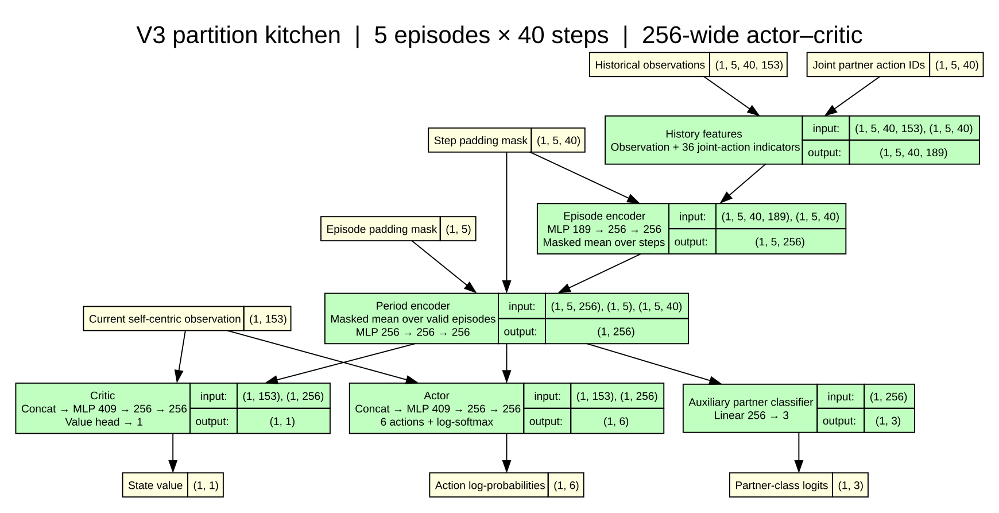

# v3 的 NestRL 风格 MLP 策略

性能测量见 [采样吞吐对照报告](runs/performance/README.md)。相同 BC 起点、63 个厨房 × 800 步的首轮短测中，两次平均耗时从 16.53 秒降到 13.52 秒，吞吐提高约 22.3%；该数字不包含整个训练流程的评估和保存成本。

## 行为克隆预训练与过程奖励（2026-11-24）

新入口是 `bc_experiment.py`。先从双锅并行脚本采集示范，再以最佳验证权重初始化 PPO；不沿用行为克隆的 Adam 状态。默认 seed 1，63 个厨房，400 步一局，800 步一轮采样，PPO 学习率 0.001，共 80 轮。正式交付分数仍为柿子鸡蛋 20、马铃薯 10、牛肉菜 50。

行为克隆采集 10 局，共 252,000 个学习岗位样本，均衡覆盖三个岗位和三种订单选择风格。输入仍为 153 维当前观测、5 局各最近 40 步的因果历史。动作损失采用普通负对数似然，附加 0.1 倍队友风格分类损失；critic 留给 PPO 学习。验证示范使用独立种子 30,000,000，与 PPO 验证的 10,000,000 分开。最多训练 10 个 epoch，按验证动作 NLL 保存最佳权重，连续 4 个 epoch 无改善则提前结束。逐动作准确率和完整训练结果保存在 `bc/bc_metrics.json`，面板只显示验证 NLL 和准确率。

训练过程奖励参考 NestRL 对配方子目标变化的计分方式，采用有界进展势能：`r_train = r_delivery + 0.99 * Phi(next) - Phi(current)`。`Phi` 只计当前三张订单所需的材料，超量库存不再累加。每份生蔬菜计 0.25，切好蔬菜及可直接入锅的鸡蛋、牛肉计 0.75，锅内或成品内的有效原料计 1；正在烹饪的菜按进度最多另计 1，熟菜计 2，厨师在正确交付侧持有成品再计 0.5。这些是状态价值，**不是每次交互固定发放的奖励**。过程奖励可能为负，终局的后续势能设为零，采样边界不清零；同一件物品反复拿放不能累计制造正的折扣回报。正式评估只统计环境的真实交付分数。

运行方式（在项目根目录）：

```powershell
$env:PYTHONPATH = "$(Resolve-Path hucooked/src);$(Resolve-Path replay_frontend/src)"
& hucooked/.conda/python.exe -m reproduction.nest_rl.mlp_partition_v3.bc_experiment --campaign counter-bc-shaped-seed1
```

重复执行同一命令时，已完成的行为克隆阶段会复用保存的模型；PPO 从最近的完整训练状态继续。策略每 5 轮保存，完整状态每 20 轮和结束时保存。每 5 轮在相同种子的 45 局上评估，与同开局的等待队伍和全脚本队伍比较；开始 PPO 前还会评估行为克隆模型。完整采样诊断保留在 `ppo/train.jsonl`，各岗位、各风格、各菜谱的详细验证结果保留在 `ppo/validation/`。

新的精简面板使用项目 **hucooked-v3-cooperation**，历史项目的数据保留。启动命令为：

```powershell
& hucooked/.conda/python.exe -m reproduction.nest_rl.mlp_partition_v3.tracking
```

浏览器打开 `http://127.0.0.1:7864/?project=hucooked-v3-cooperation`。面板共 18 个指标名：2 个 BC 指标和最多 16 个 PPO 指标。主要看 `eval/model_contribution`（模型队伍每局得分减等待队伍每局得分）、`contribution/` 下三个岗位的贡献，以及 `delivery_rate/` 下三道菜的交付率。`delivery_steps/` 显示每道菜平均出餐步数；未交付时不填零。训练实际分数与过程奖励分开显示。全脚本基线是参考水平，等待基线用于判断模型是否带来正贡献；BC 动作准确率本身不能证明模型已经学会协作。

一套策略供三个厨师共享。每次前向替一名厨师决策：读取该厨师当前的 153 维观测，以及过去与两名队友搭档时的观测和实际动作。适配器直接读取 v3 批量环境的工位和物品状态，支持共享台面与同步口。现有 46 维接口仍可用于行为克隆实验。



## 153 维观测

下标从 0 开始。厨师顺序固定为自己、按原编号升序排列的两名队友。坐标和相对位移分别按地图宽、高缩放。

| 下标 | 维数 | 字段 |
|---|---:|---|
| 0–47 | 48 | 自身坐标 2、队友位移 4、三人的朝向 one-hot 12、三人的持物 one-hot 30。 |
| 48–67 | 20 | 四个原料源、左右锅、左右交付点、最近菜板、最近可用中央交接格，各一对相对坐标。这里“可用”指地图允许交接。 |
| 68–94 | 27 | 生柿子、生马铃薯、鸡蛋、牛肉、切好柿子、切好马铃薯、三种成品，按此顺序每类给出最近一份的相对 x、相对 y 和存在标志。 |
| 95–98 | 4 | 自己手里是否有切好柿子、切好马铃薯；正前格是否有切好柿子、切好马铃薯。 |
| 99–113 | 15 | 北、南、东、西的地形阻挡标志，加正前方地形的 11 类 one-hot。 |
| 114–121 | 8 | 四块菜板的原料类型和切配进度，各 4 个值。 |
| 122–133 | 12 | 两锅各原料的存在标志、锁定菜谱和看锅进度。 |
| 134–138 | 5 | 五个中央格自上而下的暂存物编号，按 9 归一化。 |
| 139–150 | 12 | 三单按队列顺序各用三类 one-hot 编码菜谱，后接三单剩余时间，按配置中最大时限缩放。交付侧由菜谱唯一决定。 |
| 151–152 | 2 | 局内时间占比、地图是否为同步口。 |

最近物品按曼哈顿距离查找，候选包括手中物品、菜板、墙面存货、锅中已熟的成品。原料源另用固定设施坐标表示。未找到时三个值都是零；手里持有时位移也为零，但存在位为一。距离相同时按厨师编号、菜板、墙格、锅的候选顺序选择。切好的两种蔬菜各有自己的存在位，因此可直接读取“场上是否有已切柿子或马铃薯”。同类的其他副本仍可通过各工位的状态或队友持物识别。

## 历史、输出与调用

每个历史步保存当时的观测和两名队友实际执行的动作。按观测中的队友顺序，用 `6 * a + b` 合成 0–35 的联合动作编号，缺失编号用 -1，编码为全零。模型先对每步执行 `189 → 256 → 256` 的 ReLU MLP，再分别对有效步、有效局取均值；跨局 MLP 为 `256 → 256 → 256`。各有效局权重相等。Actor 和 Critic 把当前 153 维观测与 256 维历史向量拼成 409 维，各自通过两个宽度 256 的隐藏层。第三个头直接从历史向量计算伙伴类别 logits，形状为 [B, K]。K 由 num_partner_classes 指定，参考图采用 K=3。有伙伴策略标签时，可用交叉熵训练这个头；队友联合动作编号属于另一组数据。

从主项目根目录运行，使用包含 v3 的 hucooked（本次对应提交 `2d0ef37`）及其项目环境。

```python
import torch
from overcooked_ai_py.cooperative.partition import PartitionConfig
from reproduction.nest_rl.mlp_partition_v3 import OBS_DIM, V3Policy, V3PolicyKitchen, partner_action_ids

env = V3PolicyKitchen(PartitionConfig(layout="counter"), device="cuda", num_envs=4)
obs, _ = env.reset(seed=42)
policy = V3Policy().to(env.device)
# 4 个厨房 × 3 个观察者。本例为第一局分配 1 个局槽和 2 个步槽。
current = obs.flatten(0, 1)
history = current.new_zeros(12, 1, 2, OBS_DIM)
ids = torch.full((12, 1, 2), -1, dtype=torch.long, device=env.device)
pad = ids == -1
with torch.no_grad():
    logp, value, partner_logits = policy(current, history, ids, pad.all(-1), pad)
    actions = logp.exp().multinomial(1).reshape(4, 3)
    next_obs, *_ = env.step(actions)
    history[:, 0, 0] = current
    ids[:, 0, 0] = partner_action_ids(actions).flatten()
    pad[:, 0, 0] = False
    next_logp, next_value, next_partner_logits = policy(next_obs.flatten(0, 1), history, ids, pad.all(-1), pad)
```

掩码中的 True 表示忽略该步或该局；全为空的局也会自动跳过。从按时间排序的输入中至多使用最近 5 个有效局，每局至多使用最近 40 个有效步，当前局占一个局槽。默认 v3 局长仍为 300。绘图样例特意将局长设为 40，输入前四局各 40 步、第五局开局时的当前观测，共 160 个有效历史步。采样时先决策，再写入当步观测及已执行的联合动作，下一步才能读到这条记录。

```powershell
.\hucooked\.conda\python.exe -m unittest -v reproduction.nest_rl.mlp_partition_v3.test_policy
.\hucooked\.conda\python.exe -m reproduction.nest_rl.mlp_partition_v3.draw_policy
```

渲染使用 torchview 0.2.7、graphviz 0.21 和 Graphviz 的 dot 程序，结果写入本目录的 `model_graphs`。图描述模型结构，策略权重由 PyTorch 初始化。本目录提供策略、环境适配和验证入口；学习效果需要实际训练评估。

## 双锅并行队友与分菜谱奖励

环境默认奖励改为煮马铃薯 10 分、柿子鸡蛋 20 分、马铃薯柿子牛肉 50 分。`recipe_rewards=(20, 10, 50)` 按环境编号依次对应柿子鸡蛋、马铃薯、牛肉菜。同拍交付多张订单逐单相加。显式 `delivery_reward=20` 可恢复旧奖励。

`parallel-v2` 控制器为左右锅分别保留订单，允许两口锅加工任意菜谱。任务包括供料、切配、连续看锅、原料与成品跨墙运输及交付；菜谱要求的交付侧决定最终送达位置。三种风格继续决定订单优先级。规则队友读取学习者实际持物和工位变化来接续任务。

`serial-v1` 保存在 `legacy_partners.py`。训练状态新增奖励向量和控制器版本，缺少这些字段的历史检查点按旧统一 20 分及串行控制器恢复。新的 `train.py` 默认使用并行控制器与分菜谱奖励；下节的 `experiment.py` 明确保留旧实验的奖励和控制器，便于复现。

本次新旧控制器配对评估都采用新分值、400 步局长。运行记录位于 `runs/parallel-v2-comparison`，每种控制器分别评估全脚本、学习者等待和三个已有 L1 检查点，各 450 局。分菜谱得分和总得分来自环境实际奖励，交付率继续独立统计。

`dual_pots_active_steps` 统计左右锅均有食材的环境步，`dual_pots_progress_steps` 统计左右锅同拍发生投料、看锅进度或取成品的环境步。`cross_wall_pickups` 要求实际取物者位于放物者的另一侧，可按生料、切好的料、成品拆分。`idle_actionable_ingredient_steps` 只统计并行控制器中有未预留、可达且满足持物和分区条件的备料任务时仍等待的规则厨师步数。`idle_with_outstanding_work_steps` 统计有订单时所有厨师的等待，包含被阻塞的等待，读图时需区分。

Unity 回放在该实验目录的 `replays/<控制器>-<队伍>`，每个文件名注明学习岗位与风格。每份都是同一测试开局的首局，400 步、401 帧。已有素材把土豆、蛋和牛肉表示为洋葱，菜板表示为普通台面；真实物品编号、工位内容与订单倒计时保存在每帧 `state.native_state`。左右锅故意装好异侧菜的诊断轨迹在 `scenarios/dual-pot-cross-delivery`，属于人工构造的规则验收场景。

```powershell
$env:PYTHONPATH = "$(Resolve-Path hucooked/src);$(Resolve-Path replay_frontend/src)"
.\hucooked\.conda\python.exe -u -m reproduction.nest_rl.mlp_partition_v3.compare_partners
```

已完成的 4,500 局比较中，全脚本平均分从 261.80 提高到 312.00，等待学习者时从 75.84 提高到 178.96。三个现有 L1 搭配并行队友时平均分分别为 132.00、116.49、115.09，均低于新等待对照。[详细结果与限制](HANDOFF.md) · [完整评估 JSON](runs/parallel-v2-comparison/summary.json)

## 已完成的共享台面 PPO 实验

从主仓库根目录运行以下命令。训练和面板使用同一个项目环境。面板地址为 <http://127.0.0.1:7864/?project=hucooked-v3-counter-ppo>，数据存放在本目录的 `runs/trackio`。新机器先在项目环境安装 `trackio==0.44.0`。

```powershell
$env:PYTHONPATH = "$(Resolve-Path hucooked/src);$(Resolve-Path replay_frontend/src)"
.\hucooked\.conda\python.exe -m reproduction.nest_rl.mlp_partition_v3.tracking
```

在第二个终端启动实验。如果实验进程中断，用相同的实验名重新运行即可从最近的完整训练状态恢复。一个实验名同时只运行一个训练进程。

```powershell
$env:PYTHONPATH = "$(Resolve-Path hucooked/src);$(Resolve-Path replay_frontend/src)"
.\hucooked\.conda\python.exe -u -m reproduction.nest_rl.mlp_partition_v3.experiment --campaign counter-400-lr001
```

一个厨房里只有一位学习者，队友根据实际手持物、台面、锅和订单给出动作。开局按位置确定左厨与右侧两种分工，重新出生后重新绑定厨师编号。63 个厨房覆盖三岗位和三风格，每种组合 7 个。三种风格在决定下一单时分别选队首、最早到期、所需原料最少的订单，选定后持续处理到交付或到期。训练奖励为每次交付 20 分。

每局 400 步，每轮每个厨房采 800 步，共 50,400 条学习者样本。以 900 个样本为一批做 4 次遍历，每轮共 224 次优化器更新。PPO 使用 Adam、折扣 0.99、GAE 0.95、clip 0.2、价值损失权重 0.5、熵系数 0.03、梯度裁剪 15。辅助分类器的交叉熵权重为 0.1，只对已有队友历史的样本计分。目标学习率由实验指定为 0.001，前 2% 优化器步从 0.0001 线性预热。三个种子从头训练，每个 80 轮，共 4,032,000 环境步/种子。验证、全脚本与等待对照、独立测试使用相同的 400 步局长。旧的 300 步学习率筛选保存在 `runs/counter-v1`。

面板上的 `env_steps` 以厨房的时间步计数。`eval/macro_delivery_rate` 等权平均三道菜的交付率，每道菜用已交付数除以已交付加已过期数。每 5 轮用相同开局评估 45 局；未决单、各角色的表现、共享台面等待时间和逐局分类准确率分别记录。正式训练用验证集选检查点，再在独立种子上各评估 450 局。对照包括清空历史、全脚本以及学习者始终等待；等待队伍的成绩可显示规则队友能独立完成多少工作。

每个运行目录的 `train.jsonl` 记录更新，`validation/*.json` 保留完整的岗位、风格、菜谱和分类混淆矩阵明细。策略文件每 5 轮保存为 `policy_*.pt`；含优化器、环境、历史、队友和随机流的 `checkpoint_*.pt` 每 20 轮和运行结束时保存。筛选和独立测试汇总位于 `runs/<实验名>/summary.json`。

## 分岗位课程训练（2026-11-24）

`curriculum_experiment.py` 从已有 `counter-bc-shaped-seed1/bc/bc_best.pt` 重开训练，不继承退化的 PPO 权重。当前默认 128 个厨房，前三阶段依次重点训练左厨、右侧主厨、右侧传菜，岗位分配分别为 `(92,18,18)`、`(18,92,18)`、`(18,18,92)`；第四阶段用 `(43,43,42)` 联合微调。三种风格在整体和各岗位内部尽量均衡，数量差至多一。每局仍为 400 步，每轮每个厨房采样 800 步，原生分数和过程奖励不变。

前三阶段目标学习率改为 0.0003，联合阶段改为 0.0001，每阶段重新 warmup。每次 PPO mini-batch 额外抽取 180 条三岗位均衡示范，以 0.1 倍动作负对数似然保留基本技能；示范使用独立种子 40,000,000，63 个厨房各 5 局，共 126,000 样本，因果历史索引缓存在 `demonstrations.pt`。近似 KL 超过 `1.5 × 0.02` 时停止该轮剩余优化，下一轮重新采样。

128 厨房下每阶段最多 10 轮，即 1,024,000 个环境步，比原 63 厨房的 20 轮（1,008,000 步）多约 1.59%；四阶段最多 4,096,000 步。评估按每 252,000 环境步的阈值安排，在采样跨过阈值后进行固定种子的 45 局验证，因此当前每阶段在第 3、5、8、10 轮评估。连续两次满足条件才具备晋级资格：当前重点岗位超过等待基线；已经学过的岗位保持参考分数的至少 90%；左厨模式下柿子鸡蛋和牛肉菜均有实际交付。参考分数至少为 BC 分数，并在阶段转换时取此前参考与本次评估分数的较高者。联合阶段要求三个岗位均超过等待基线且保住参考水平。若达到阶段预算仍未合格，记录 `needs_attention` 和原因并停止，不自动跳过失败岗位。

阶段转换保留网络与 Adam，重置厨房与历史；转换只发生在完整五局历史组边界，即当前第 5 或第 10 轮。如果第 8 轮刚达到连续两次合格，会继续训练并等第 10 轮再次验证后决定晋级，恢复运行也遵守该限制。`latest.pt` 在每个评估点、阶段边界及指定短跑结束时保存完整状态；`policy_*.pt` 保存评估点，`accepted_<岗位>.pt` 保存通过阶段门槛的策略。`status.json` 每轮记录当前阶段、进度和门槛原因，`summary.json` 对应最近完整状态。用同一命令重启会恢复最近完整状态，已结束或需处理的实验不会自行继续。

```powershell
$env:PYTHONPATH = "$(Resolve-Path hucooked/src);$(Resolve-Path replay_frontend/src)"
& hucooked/.conda/python.exe -u -m reproduction.nest_rl.mlp_partition_v3.curriculum_experiment --campaign counter-curriculum-128-lr0003-seed1
```

Trackio 仍使用 `hucooked-v3-cooperation`，新运行名为 `counter-curriculum-128-lr0003-seed1-ppo-seed1`；保留原精简指标并增加 `curriculum/stage`（1 左厨、2 主厨、3 传菜、4 联合）。阶段轮数和全局轮数、完整优化诊断写入本地 `train.jsonl`。

旧的 `counter-curriculum-seed1` 使用 63 厨房、每阶段 20 轮、重点阶段 0.001、联合阶段 0.0003，记录保留作对照。需要读取该运行的恢复状态时显式传入 `--num-envs 63 --stage-updates 20 --focus-lr 0.001 --joint-lr 0.0003`；63 厨房的低学习率实验则只需前两个覆盖参数。配置检查会拒绝在同一目录内悄悄改变训练设置。新实验从同一 BC 权重重新开始。若阶段最后一次评估合格，但没有连续两次合格，停止原因会明确显示通过次数，例如 `1/2`。

并发厨房数可用 `--num-envs` 指定，要求为至少 9 的整数，岗位分配按原比例取整且每岗位至少 3 个厨房。验证仍为 45 局，防遗忘示范库仍用 63 个厨房采集。`--eval-env-steps` 默认 252000；任意自定义并发和轮数不会自动保持总预算，需要按 `厨房数 × 800 × 阶段轮数` 核对。实验配置和面板横轴记录实际环境步数。

用户随后要求试运行 252 个厨房，使用独立实验名 `counter-curriculum-252-lr0003-seed1`。指定 `--num-envs 252 --stage-updates 5`，前三阶段岗位分配为 180/36/36 轮换，联合阶段为 84/84/84。每阶段预算 `252 × 800 × 5 = 1,008,000` 环境步，与最初 63 厨房的 20 轮完全相同；四阶段最多 4,032,000 步。按同一 252,000 步评估阈值，第 2/3/4/5 轮评估；完整历史组边界在第 5 轮，提前连续通过也要等第 5 轮重新验证后才能切换。学习率仍为重点阶段 0.0003、联合 0.0001。

```powershell
& hucooked/.conda/python.exe -u -m reproduction.nest_rl.mlp_partition_v3.curriculum_experiment --campaign counter-curriculum-252-lr0003-seed1 --num-envs 252 --stage-updates 5
```

最终确定的 252 厨房运行改为每个厨房每轮采样 **400 步，即一整局**，每阶段最多 10 轮，实验名为 `counter-curriculum-252x400-lr0003-seed1`。每阶段仍是 `252 × 400 × 10 = 1,008,000` 环境步，四阶段最多 4,032,000 步。验证回到第 3/5/8/10 轮；五局历史组边界为第 5/10 轮，第 8 轮不会提前晋级。此运行使用以下显式参数，未修改入口的 128 厨房默认值：

```powershell
& hucooked/.conda/python.exe -u -m reproduction.nest_rl.mlp_partition_v3.curriculum_experiment --campaign counter-curriculum-252x400-lr0003-seed1 --num-envs 252 --rollout-steps 400 --stage-updates 10
```

后续 1000 步采样试验使用 `counter-curriculum-252x1000-lr0003-seed1`。这里仅把每次采样长度改为 1000，局长仍为 400；每轮跨过 2.5 局，奇数轮结束时会保留当前局的后半段到下轮继续，不能在采样边界重置环境或历史。每阶段最多 4 轮，预算仍为 `252 × 1000 × 4 = 1,008,000` 环境步，四阶段上限 4,032,000。每轮评估一次，完整五局历史组边界在第 2/4 轮，晋级只能在这些边界发生。完整检查点保留半局状态，恢复后从保存的步数继续。入口检查阶段总采样步数能否被 `局长 × 5` 整除，采样长度本身不再要求整局对齐。

```powershell
& hucooked/.conda/python.exe -u -m reproduction.nest_rl.mlp_partition_v3.curriculum_experiment --campaign counter-curriculum-252x1000-lr0003-seed1 --num-envs 252 --rollout-steps 1000 --stage-updates 4
```

## 固定四阶段重训（504 厨房，每阶段 10 轮）

最新实验入口为 `fixed_curriculum_experiment.py`，从同一个 BC 最佳权重完整重开四个阶段。每阶段固定采样并更新 10 轮，顺序是左厨、右侧主厨、右侧传菜、联合微调。评估成绩只用于记录，不触发提前晋级，也不因旧岗位退步停止。旧的带门槛入口保留，方便复现此前实验。

当前配置为 504 个厨房、每局 400 步、每轮每厨房采样 800 步。重点阶段的岗位分配为 360/72/72 轮换，联合阶段为 168/168/168；前三阶段学习率 0.0003，联合阶段 0.0001。持续 BC 示范损失权重 0.1，KL 目标 0.02，原生交付奖励和训练过程奖励保持原设置。KL 限制只结束当轮剩余优化，不结束课程或缩短固定 10 轮采样预算。

每轮 403,200 环境步，每阶段 4,032,000 步，四阶段合计 40 轮、16,128,000 环境步。初始模型和每阶段第 2/4/6/8/10 轮均进行 45 局固定种子验证，即训练中每 806,400 环境步评估一次。只有完成第 10 轮才切换岗位，切换时保留模型及 Adam，重置厨房、历史和该阶段 warmup；10 轮对应完整五局历史组边界。

```powershell
$env:PYTHONPATH = "$(Resolve-Path hucooked/src);$(Resolve-Path replay_frontend/src)"
& hucooked/.conda/python.exe -u -m reproduction.nest_rl.mlp_partition_v3.fixed_curriculum_experiment --campaign counter-fixed-504x800-lr0003-seed1
```

Trackio 项目仍为 `hucooked-v3-cooperation`，运行名为 `counter-fixed-504x800-lr0003-seed1-ppo-seed1`。`latest.pt` 在每次验证、阶段边界和指定短跑结束时保存完整状态；`finished_<stage>.pt` 保存完成该阶段的模型，文件名不代表成绩达标。`--stop-after` 仅供短跑或中途保存，保留 `running` 状态；同命令恢复会继续未完成的轮次。只有四个阶段累计完成 40 轮后才标记 `complete`。

## 随机初始化直接 PPO：504×2000

最新的从头训练使用 `fixed_curriculum_experiment.py --from-scratch`。该模式直接按 seed 初始化网络与全新的 Adam，不读取 BC 权重，不采集或加载示范库，也不加入行为克隆损失（`bc_coefficient=0`）。随机初始权重保存为 `initial_random.pt`，起点评估保存为 `validation-initial.json`；恢复训练加载 `latest.pt` 的模型与优化器，不会再次用随机权重覆盖已训练状态。原有不带此开关的 BC 模式保持兼容。

正式实验名为 `counter-fixed-504x2000-scratch-seed1`。504 个厨房、局长 400、每次采样 2000 步（一组完整五局历史），四阶段各固定 10 轮。每轮 1,008,000 环境步，每阶段 10,080,000 步，总计 40,320,000 步。角色仍按 360/72/72 轮换，联合 168/168/168；前三阶段学习率 0.0003、联合 0.0001。训练过程奖励、辅助分类系数 0.1、KL 目标 0.02 保留；得分不触发提前晋级或停止。每阶段第 2/4/6/8/10 轮做 45 局验证。

```powershell
& hucooked/.conda/python.exe -u -m reproduction.nest_rl.mlp_partition_v3.fixed_curriculum_experiment --campaign counter-fixed-504x2000-scratch-seed1 --num-envs 504 --rollout-steps 2000 --from-scratch
```

新运行仅可复用同配置的等待、全脚本基线；随机起点评估必须对应当前 seed 的初始网络，不能复制 BC 起点评估。配置中记录 `initialization=random`、`initialization_seed`、空 BC 路径和 `bc_coefficient=0`，与先做 BC 的实验区分。
