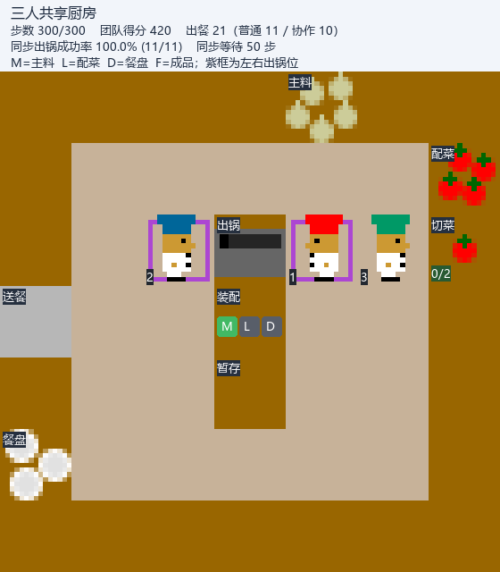

# HuCooked 持续补单场景的 MAT 实验

本分支把 Multi-Agent Transformer 应用于三人 SharedKitchen。模型读取三名厨师的观测，依次生成三个动作，再把联合动作交给环境。评估阶段的三个厨师均由模型控制。 [MAT 论文](https://proceedings.neurips.cc/paper_files/paper/2022/hash/69413f87e5a34897cd010ca698097d0a-Abstract-Conference.html)

## 实测结果

归档实验使用环境 `de37e0818c2e76311e105ab8689e5162bd84133f`；当前 `main` 统一使用 `overcooked_env@508bcbf`，评测入口仍逐一校验归档清单中的 44 个环境文件。模型权重位于根目录 `runs/mat/`。各策略都用默认持续补单设置评估 128 局，每局 300 步。评估种子为 `200000–200127`，覆盖全部 6 种出生位置分配。表中的指标取自各局结束时环境返回的 `info["metrics"]`，再按局取平均。

| 策略 | 平均出餐数 | 平均团队得分 | 同步成功率 | 每局等待步数 |
|---|---:|---:|---:|---:|
| 固定 8 单场景的旧权重，直接评估 | 8.00 | 160.00 | 17.39% | 19.00 |
| 持续补单示范微调，第 32 轮 | 21.00 | 420.00 | 100.00% | 50.00 |
| PPO 最佳检查点，第 12 次更新 | **21.00** | **420.00** | **100.00%** | **50.00** |

最终检查点在 128 局中每局都拿到 420 分。 [逐局数据](results/ppo-128.json) · [核验报告](results/verification.json)

## 游戏实跑

回放使用种子 `200000` 和最终 PPO 权重，从初始状态到第 300 步逐帧录制。该局实际交付 11 单普通订单、10 单协作订单，累计 420 分。动作与事件日志记录了每步的三个动作、环境奖励和原生事件。 [完整游戏动画](replay/episode.gif) · [300 步动作与事件](replay/trace.json)



## 复现评估和回放

本次使用 Python 3.12.9、PyTorch 2.6.0 CPU 版和 2 个 PyTorch 线程。从仓库根目录执行下列命令。可以在已有的 Python 虚拟环境中安装依赖。

```bash
git submodule update --init overcooked_env
python -m pip install --index-url https://download.pytorch.org/whl/cpu torch==2.6.0
python -m pip install -r src/mat/requirements.txt
python -m src.mat.evaluate_shared --output mat-evaluation.json
python -m src.mat.verify_shared --output mat-verification.json
python -m src.mat.replay_shared --seed 200000 --output mat-replay
```

核验程序会检查 44 个环境文件的 Git 对象哈希和权重的 SHA-256，重新跑完 128 局并比对每局原始指标。它还会从回放种子重新计算每一步的 MAT 动作，逐步比对环境事件和奖励。 [环境清单](environment-manifest.json)

## 从归档权重重跑训练

1. 从固定 8 单场景的归档权重出发。用 6 种出生位置分配生成完整的 300 步示范，共 1,800 个环境步。示范包含提前备菜和两名厨师到位后同步卸锅。微调到第 32 轮时，模型在持续补单环境中可完成 21 单。
2. 使用环境原始出餐奖励继续做 PPO，共 20 次更新、18,000 个环境步。训练期间用另外 12 个种子选权重。第 12 次更新在验证中取得 420 分，因此选作最终权重。第 20 次更新的验证均分回落至 315 分。示范微调版与选出的 PPO 版在 128 局复评中得分相同。 [示范统计](results/demonstrations.json) · [示范微调日志](results/imitation-progress.jsonl) · [PPO 日志](results/ppo-progress.jsonl)

```bash
python -m src.mat.train_continuous --run-dir runs/mat/experiments/imitation --initialize runs/mat/fixed-8.pt --epochs 192 --eval-every 16 --seed 0
python -m src.mat.train_continuous --run-dir runs/mat/experiments/ppo --initialize runs/mat/experiments/imitation/best.pt --ppo-updates 20 --eval-every 4 --learning-rate 0.00001 --seed 0
python -m src.mat.evaluate_shared --checkpoint runs/mat/experiments/ppo/best.pt --seed 200000 --episodes 128 --output runs/mat/experiments/ppo-128.json
```

我在提交前用上述参数重跑了示范微调和 PPO。两个阶段重新选出的检查点各有 52 个模型张量，逐项与归档一致。 [重跑核验记录](results/training-verification.json)

[训练入口](train_continuous.py) · [评估入口](evaluate_shared.py) · [最终权重](../../runs/mat/shared-ppo-best.pt)
